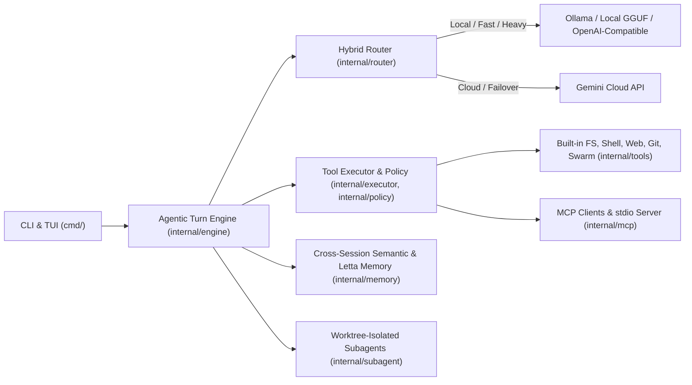

# Microgravity (`mg`) 🌌

[](https://github.com/CmfH009/microgravity/actions/workflows/ci.yml)
[](https://github.com/CmfH009/microgravity/releases)
[](https://github.com/CmfH009/microgravity/blob/master/go.mod)
[](https://github.com/CmfH009/microgravity/blob/master/LICENSE)

**Microgravity (`mg`)** is a fast, local-first autonomous AI agent CLI and multi-agent swarm runtime written in Go. It combines local Ollama/GGUF/OpenAI-compatible models with cloud Gemini failover, Model Context Protocol (MCP) extensibility, AST context compression, cross-session semantic memory, and an interactive Bubble Tea TUI.

```text
   __  ____                                        _ __
  /  |/  (_)_____________  ____ __________ __   __(_) /___  __
 / /|_/ / / ___/ ___/ __ \/ __ `/ ___/ __ `/ | / / / __/ / / /
/ /  / / / /__/ /  / /_/ / /_/ / /  / /_/ /| |/ / / /_/ /_/ /
/_/  /_/_/\___/_/   \____/\__, /_/   \__,_/ |___/_/\__/\__, /
                          /____/                       /____/

    🌌  M I C R O G R A V I T Y   A I   E N V I R O N M E N T
  Autonomous Copilot Engine • Multimodal Gemma & Gemini Matrix
```

---

## 🏗️ System Architecture



See [docs/ARCHITECTURE.md](docs/ARCHITECTURE.md) for module-level internals.

---

## ⚡ Key Capabilities

- **Full Antigravity (`agy`) Tool Suite Parity**:
  - `run_command` with synchronous wait timeout (`WaitMsBeforeAsync`), asynchronous background task execution, streaming task logs (`.system_generated/tasks/`), and reactive message notifications.
  - `manage_task` (`list`, `kill`, `status`, `send_input`) for inspecting and controlling background processes and piping stdin input.
  - `invoke_subagent` and `define_subagent` for dynamic subagent role definition and parallel multi-subagent dispatch.
  - `manage_subagents` (`list`, `kill`, `kill_all`) with rich state lifecycles (`running`, `idle`, `waiting_for_input`, `waiting_for_dependents`, `waiting_for_message`, `canceling`, `errored`, `completed`, `killed`).
  - `send_message` for thread-safe inter-agent messaging.
  - `call_mcp_tool` for dynamic lazy and eager MCP tool invocation across connected servers.
  - `search_web` (with query, domain filters, and citation formatting) and `read_url_content` (HTML-to-markdown extraction).
  - `generate_image` (generates UI mockups, diagrams, and layout artifacts stored in the brain artifact registry).
  - `schedule` (one-shot duration timers with condition triggers `never`, `any`, `<sender-id>`, and recurring cron schedules).
  - `view_file` (1-indexed slicing, 46KB truncation, `ContentOffset`), `write_to_file` (with secret-write guard & write-ahead journal), `replace_file_content` (CRLF-aware matching), `grep_search`, `find_by_name`, and `list_dir`.
- **Conversation Transcripts & Brain Architecture (`~/.gemini/antigravity-cli/brain/`)**:
  - AGY JSONL specification support for `transcript.jsonl` (compact with `truncated_fields`) and `transcript_full.jsonl` (untruncated full steps).
- **Local-First Multi-Tier & OpenAI-Compatible Routing**:
  - Run 100% offline with `--local` / `--routing-mode local-only` (auto-classifying simple vs. complex prompts across fast/heavy local Ollama models with zero cloud requests), or connect to any OpenAI-compatible server (`llama-server`, LM Studio, vLLM, Ollama `/v1`) via `--base-url` / `MG_OPENAI_BASE_URL`.
- **Interactive TUI v2 & Slash Commands**:
  - Alternate-screen Bubble Tea pickers (`/model`, `/skills`, `/sessions`), scrollable streaming viewport, collapsible tool cards (`Tab`), inline unified diff approval modal (`[a]`pprove / `[r]`eject / `[A]`lways allow), live theme switcher (`/theme`), checkpoint rewind picker (`/rewind`), split-pane subagent monitor (`/swarm`), plus `/local`, `/caveman`, `/goal`, `/schedule`, `/plan`, `/grill-me`, `/teamwork-preview`, `/learn`, `/dashboard`, `/fix`, `/ci`, `/rules`, `/mcp`, `/subagents`.

---

## 🤖 Model Catalog & Hugging Face Hub (GGUF)

Microgravity ships an expanded catalog spanning **Gemini 3 / 2.5 / 2.0 / 1.5**, **Gemma 4 / 3 / 2**, **Orbit personas**, **Qwen 2.5 Coder / Qwen 3**, **DeepSeek-R1 / Coder-V2**, **Llama 3.2 / 3.3**, **Mistral / Devstral**, **Phi-4**, **GPT-OSS**, locally discovered `.gguf` files, and live **Hugging Face Hub** search:

```bash
# Interactive alternate-screen model selector (Tab to filter, / to search, h for HF search, d to download)
mg models            # or /model inside chat

# List and filter local, downloaded, or categorized models
mg models list --local
mg models list --downloaded --json

# Search Hugging Face GGUF repositories and download the best quantization for your PC's RAM
mg models search "qwen2.5 coder"
mg models hf-download Qwen/Qwen2.5-Coder-7B-Instruct-GGUF --select
mg models auto "qwen2.5 coder" --select
mg models auto "qwen2.5 coder" --ollama --select

# Inspect or switch active model
mg models current
mg models select gemma4:e2b
```

---

## 🚀 CLI Command Reference

| Command | Description |
| :--- | :--- |
| `mg` / `microgravity` | Launch the interactive AI agent session |
| `mg agent` / `agents` | List available built-in and specialized agent roles |
| `mg audit [--fix]` | Run workspace setup and health audit |
| `mg budget [--json\|--reset]` | View or reset daily token & cost budget usage |
| `mg changelog` | Show changelog and release notes |
| `mg ci [-o .github/workflows]` | Generate production GitHub Actions workflows |
| `mg completion [bash\|zsh\|fish\|powershell]` | Generate shell completion scripts |
| `mg compress [file]` | Compress file / AST token pruning |
| `mg dashboard [--live] [-w] [-p 8085]` | Launch Bubble Tea live TUI & Web Telemetry Control Center |
| `mg diff [--staged] [--stat] [--file <path>] [--last-session]` | Show styled unified diff of working tree or staged changes |
| `mg doctor [--json]` | Run diagnostics on config, auth, models, Ollama, MCP, and state |
| `mg fix [-a 5] [-c]` | Autonomous self-healing test repair & doubt loop |
| `mg graph [-p] [-s] [-a]` | Render ASCII dependency tree |
| `mg install [--dir] [--skip-path]` | Configure environment paths & shell settings |
| `mg mcp <subcommand>` | Manage MCP servers (`add`, `remove`, `list`, `enable`, `disable`, `inspect`, `discover`, `serve`) |
| `mg mcp serve` | Run mg as a stdio JSON-RPC MCP server exposing all native tools |
| `mg memory <query> \| --clear` | Search or clear cross-session semantic memory |
| `mg models [list\|select\|current\|search\|hf-download\|auto]` | Scan, search, download, and select local/cloud/GGUF models |
| `mg plugin <subcommand>` | Manage plugins (`list`, `import`, `install`, `uninstall`, `enable`, `disable`, `validate`, `link`) |
| `mg preview [-p 3000]` | Start hot-reloading web app preview server |
| `mg profile [pkg]` | Benchmark and runtime memory profiling |
| `mg replay [<session-id>\|--list\|--interactive]` | Replay recorded AGY JSONL session transcripts |
| `mg sessions [list\|delete\|export\|import]` | Manage and export (`--format md\|json`) saved chat sessions |
| `mg skills` | Browse, search, and inspect installed AGY skills |
| `mg subagents list` | List active subagent threads |
| `mg swarm [tasks...]` | Launch parallel worker subagent swarm |
| `mg undo [n]` | Revert the last n file modifications (write-ahead journal) |
| `mg update` | Update CLI to latest release |

---

## 🚩 Root Flags Reference

| Flag | Description |
| :--- | :--- |
| `--add-dir` | Add a directory to the workspace (repeatable) |
| `--agent` | Select agent persona for the CLI session (`self`, `research`, `code-reviewer`, `security-auditor`, `test-engineer`, `web-performance-auditor`) |
| `--base-url` | OpenAI-compatible local/custom endpoint base URL (also read from `MG_OPENAI_BASE_URL`) |
| `-c`, `--continue` | Continue the most recent conversation |
| `--conversation` | Resume a previous conversation by ID |
| `--dangerously-skip-permissions` | Auto-approve all tool permission requests without prompting |
| `--dry-run` | Preview planned tool calls without executing them |
| `--disable-slash-commands` | Disable slash command and skill expansion in print mode |
| `--effort` | Reasoning effort for the session (`low`, `medium`, `high`) |
| `-i`, `--prompt-interactive` | Run an initial prompt interactively and continue the session |
| `--input-format` | Input format for print mode (`text`, `stream-json`) |
| `--local` | Run strictly offline in `local-only` routing mode (skips cloud auth prompts) |
| `--local-fast-model` | Local fast-tier model name for simple prompts |
| `--local-heavy-model` | Local heavy-tier model name for complex coding/reasoning prompts |
| `--output-format` | Output format for print mode (`text`, `json`, `stream-json`) |
| `--json-schema` | Enforce structured output validation against JSON schema |
| `--log-file` | Override CLI log file path |
| `--mode` | Set agent execution mode (`accept-edits`, `plan`, `default`) |
| `--model` | Model for the current CLI session |
| `--new-project` | Create a new project for this session |
| `-p`, `--print` / `--prompt` | Run a single prompt non-interactively and print response |
| `--print-timeout` | Timeout for print mode wait (default 5m0s) |
| `--project` | Project ID or project name for the CLI session |
| `--routing-mode` | Provider routing policy (`hybrid`, `local-only`, `cloud-only`; env `MG_ROUTING_MODE`) |
| `--sandbox` | Run in sandbox with terminal restrictions enabled |
| `--theme` | UI theme (`auto`, `dark`, `light`, `tokyo-night`, `catppuccin`, `high-contrast`) |

---

## 🧠 Local-First & OpenAI-Compatible Inference

Run Microgravity completely offline without cloud API keys or credits:

```bash
# Local-only multi-tier routing via Ollama (never dials cloud endpoints)
mg --local
mg --routing-mode local-only --local-fast-model gemma4:e2b --local-heavy-model qwen2.5-coder:7b

# Or set via environment variable
export MG_ROUTING_MODE=local-only

# Connect to any OpenAI-compatible local server (llama-server, LM Studio, vLLM, Ollama /v1)
mg --base-url http://127.0.0.1:8080/v1 --model local-model
# Or via environment variable:
export MG_OPENAI_BASE_URL=http://127.0.0.1:11434/v1
```

---

## 🎨 Interactive TUI Controls & Views

| Control / Slash Command | Action |
| :--- | :--- |
| `/model` | Open alternate-screen model catalog, filter tabs, and Hugging Face downloader |
| `/theme [name\|auto]` | Live-switch between `auto`, `dark`, `light`, `tokyo-night`, `catppuccin`, and `high-contrast` |
| `/rewind` | Open interactive checkpoint picker to inspect and revert workspace turns |
| `/swarm` | Toggle split-pane subagent/swarm status monitor |
| `/local` | Toggle local-only routing directly inside an active session |
| `Tab` | Expand or collapse tool execution cards (or cycle filter tabs in `/model`) |
| `a` / `r` / `A` | Approve once, reject, or always allow in session inside the inline diff approval modal |
| `PgUp` / `PgDn` / Mouse Wheel | Scroll through conversation and tool output history |

---

## 📦 Installation & Builds

### Install via Go

```bash
go install github.com/CmfH009/microgravity@latest
```

### Homebrew & Scoop Release Artifacts

Every tagged GitHub Release (`v*.*.*`) automatically publishes cross-compiled binaries, `checksums.txt`, a **Homebrew formula** (`microgravity.rb`), and a **Scoop manifest** (`microgravity.json`):

```bash
# macOS (ARM64) / Linux (amd64) via release Homebrew formula
brew install https://github.com/CmfH009/microgravity/releases/latest/download/microgravity.rb
```

```powershell
# Windows (64-bit) via release Scoop manifest
scoop install https://github.com/CmfH009/microgravity/releases/latest/download/microgravity.json
```

### Local & Cross-Platform Builds

```bash
# Build from source in repository root
go build -ldflags="-s -w" -o mg .

# Cross-compile static binaries (CGO_ENABLED=0)
CGO_ENABLED=0 GOOS=linux GOARCH=amd64 go build -ldflags="-s -w" -o dist/mg-linux-amd64 .
CGO_ENABLED=0 GOOS=windows GOARCH=amd64 go build -ldflags="-s -w" -o dist/mg-windows-amd64.exe .
CGO_ENABLED=0 GOOS=darwin GOARCH=arm64 go build -ldflags="-s -w" -o dist/mg-darwin-arm64 .
```

### Verification & Tests

```bash
go vet ./...
CGO_ENABLED=1 GEMINI_API_KEY="" GOOGLE_API_KEY="" go test -race -count=1 ./...
python -m unittest discover -s tests -p "test_*.py"
```

---

## 📁 Repository Structure

```text
microgravity/
├── cmd/                  # Cobra CLI commands, interactive chat loop, Bubble Tea TUI, MCP stdio server
├── internal/
│   ├── engine/           # Turn loop, session state, history persistence, failover dispatch
│   ├── router/           # Complexity classifier & hybrid/local-only/cloud-only provider routing
│   ├── models/           # Model catalog, Ollama/GGUF scanner, & Bubble Tea /model picker
│   ├── huggingface/      # Hugging Face Hub search, GGUF selector & resumable downloader
│   ├── cloud/ & ollama/ & openai/ # Provider clients, streaming tool-call parsers & retry backoff
│   ├── tools/ & executor/ & policy/ # Native tool registry, TTL cache, secret guard, write journal
│   ├── mcp/              # Model Context Protocol stdio/HTTP client & server
│   ├── memory/ & rag/    # Feature-hashing offline semantic memory (SQLite)
│   ├── subagent/ & swarm/# Parallel subagents, git worktree isolation & EventBus integration
│   └── ui/               # Lip Gloss themes, panels, collapsible tool cards, diff modal, sparklines
├── python/               # Python sidecars (browser tool, Letta memory adapter, EventBus backpressure)
├── scripts/              # Helper sidecar forwarders and OAuth/CV utilities
├── tests/                # Go E2E/chaos/benchmark suites and Python unittest suites
├── vscode-extension/     # Microgravity IDE companion extension
└── docs/                 # Architecture, specs, roadmaps, and VHS demo tape
```

---

## ⚙️ Portable Sidecar & Profile Discovery

Python sidecar integrations, user/agent rule profiles, and MCP helpers resolve paths portably without hardcoded machine-specific directories:

| Variable | Purpose | Resolution Order |
| :--- | :--- | :--- |
| `MG_PYTHON` | Python interpreter path or command name | `MG_PYTHON` -> `VIRTUAL_ENV` -> local `.venv` (cwd or executable directory) -> system `PATH` -> `"python"` |
| `MG_SIDECAR_DIR` | Explicit directory containing sidecar scripts | Checked directly first (`<relPath>` / `<fallbackName>`), then `python/` and `scripts/` subdirectories (does not walk parent directories) |
| `MG_HOME` | Base Microgravity installation & profile directory | Sidecars: checked after `MG_SIDECAR_DIR`; Profiles (`user_profile.md` / `agent_profile.md` / uppercase): `MG_HOME` -> `AGY_HOME` -> `~/.microgravity/` -> `~/.gemini/antigravity-cli/` |
| `AGY_HOME` | Secondary AGY home directory for profiles & helpers | Checked after `MG_HOME` and before `~/.microgravity/` and `~/.gemini/antigravity-cli/` |
