```mermaid
flowchart TD
    subgraph Foundation ["Current Operational Foundation (R1 - R3 Completed)"]
        R1["R1: Engine Hygiene & Bug Hardening\n• Path deduplication\n• Pruned duplicate verification\n• CRLF line normalization\n• Flag forwarding"]
        R2["R2: Reactive Loops & Token Scaling\n• Turn 0 root prompt preservation\n• Model-adaptive token ceilings (8k-32k)\n• EventBus topic routing\n• Worktree session isolation"]
        R3["R3: Modern Protocols & Hierarchical Memory\n• Letta 3-tier memory (Core, Episodic, Archival)\n• Browser-Use Dual-Engine (Playwright + Fallback)\n• Native function schemas (Gemini/Ollama)"]
    end

    subgraph Phase4 ["Phase 4: IDE, API Server & Tool Ecosystem (Months 1–2)"]
        P4E1["Epic 4.1: Production-Grade 'mg serve' Gateway\n• Full OpenAI & Anthropic v1 endpoints\n• Tool calling & SSE streaming\n• Context cancellation & client disconnect"]
        P4E2["Epic 4.2: VS Code Extension & LSP Integration\n• Real-time Agent HUD & TreeViews\n• Inline FIM code completion\n• Bidirectional IPC Daemon"]
        P4E3["Epic 4.3: Bidirectional MCP Gateway & Virtual FS\n• Microgravity as MCP Server\n• Hot-reloading server connections\n• Resilient circuit breakers"]
    end

    subgraph Phase5 ["Phase 5: Swarm Mesh & Multimodal Perception (Months 3–4)"]
        P5E1["Epic 5.1: Distributed Peer Swarm Mesh\n• gRPC / WebSocket peer federation\n• Capability discovery & worker gossip\n• Shared blackboard & worktree sync"]
        P5E2["Epic 5.2: Letta Compaction Daemon & Hybrid Vector\n• Automated episodic compaction worker\n• SQLite-vec / BM25 hybrid ranking\n• Dynamic contextual prompt assembly"]
        P5E3["Epic 5.3: Visual Terminal & Headless Verification\n• PTY terminal snapshotting (ANSI->SVG/PNG)\n• VLM visual self-correction loop\n• Doubt-driven visual assertions"]
    end

    subgraph Phase6 ["Phase 6: Autonomous Eval & Self-Evolution (Month 5+)"]
        P6E1["Epic 6.1: Local SWE-Bench Harness ('mg bench')\n• Deterministic test suites & token efficiency\n• Regressive regression benchmarks"]
        P6E2["Epic 6.2: Autonomous Skill Synthesis\n• Trajectory abstraction to dynamic skills\n• Self-healing agent rulebook"]
    end

    Foundation --> Phase4
    Phase4 --> Phase5
    Phase5 --> Phase6
```

# Microgravity (`mg`) Strategic Roadmap: Phase 4 & Phase 5
## Autonomous AI Engineering Agent Framework

**Author**: Principal Systems Architect  
**Target Codebase**: `A:\projects\microgravity`  
**Base Systems**: Go 1.24 Core Agent Engine, Python Letta/Browser Adapters, Antigravity EventBus  
**Roadmap Version**: 2.0.0 (Post-R1/R2/R3 Upgrade)  
**Status**: Approved Strategic Engineering Blueprint  

---



---

## 1. Executive Summary & Ground-Truth Baseline

Microgravity (`mg`) has achieved architectural maturity following the completion of its foundational strategic initiatives:
1. **R1 (Engine Hygiene & Hardening)**: Eliminated recursive path pollution, resolved duplicate auto-verification passes in batch loops, normalized Windows CRLF line endings in file content replacements, and propagated flags (`--add-dir`, `--sandbox`) across session factories.
2. **R2 (Reactive Loops & Token Scaling)**: Preserved Turn 0 user intent during context truncation, instituted model-adaptive dynamic token limits (32k for Gemini, 8k for Gemma), separated subagent execution states, and wired background notification triggers.
3. **R3 (Protocol & Memory Modernization)**: Deployed the Letta 3-tier memory hierarchy (`core_memory_blocks`, `episodic_events`, `archival_passages`), instituted the Playwright/HTTP fallback browser automation system, and structured native Gemini & Ollama schema generation.

### Ground-Truth Inventory: What Exists on Disk Today

| Component | Physical Path | Current State | Deficiencies to Resolve |
| :--- | :--- | :--- | :--- |
| **API Server** | `cmd/serve.go` | Functional HTTP server with `/generate`, `/health`, `/status`, `/v1/models`, `/v1/chat/completions`, and `/v1/completions`. | Lacks tool calling emulation, Anthropic `/v1/messages` endpoint, client disconnect cancellation, and API authentication. |
| **VS Code Extension** | `vscode-extension/` | Basic extension structure with command triggers, status bar button, and static Webview HUD. | Uses one-way terminal execution (`runInTerminal("mg run ...")`), lacks inline code completion provider, has no real-time telemetry streaming from the agent, and lacks VSIX automated build scripts. |
| **Mesh Client & EventBus** | `python/microgravity_mesh_client.py`<br>`python/eventbus/client.py`<br>`internal/events/events.go` | Python WebSocket client publishing to `ws://127.0.0.1:8765`. Go internal in-memory channel event bus. | Go engine and Python client are decoupled. Subagents in Go do not publish directly to the WebSocket mesh; no peer-to-peer worker gossip exists across machines. |
| **Letta Memory Module** | `python/letta/mg_memory_letta.py`<br>`internal/tools/letta_memory.go` | SQLite WAL storage with BM25 keyword matching and synchronous compaction functions. | Compaction is manual; lacks vector embedding integration (SQLite-vec) and background daemon scheduling. |
| **Browser-Use System** | `python/browser/mg_tool_browser.py`<br>`internal/tools/browser.go` | Dual-engine (Playwright + zero-dependency HTML parser) with screenshot & action planning. | Terminal TUI screenshot capture is not connected to browser vision loop; no visual assertion tools. |

---

## 2. Phase 4: IDE, API Server & Tool Ecosystem (Months 1–2)

Phase 4 elevates Microgravity from a standalone terminal CLI to an ubiquitous coding companion accessible by any IDE, API client, or external agent framework.

```
┌─────────────────────────────────────────────────────────────────────────────┐
│                       Phase 4 Architecture Overview                         │
├─────────────────────────────────────────────────────────────────────────────┤
│                                                                             │
│   VS Code Extension (extension.js) ◄────┐                                   │
│     - Inline Code Completion (FIM)      │                                   │
│     - Live Agent HUD & Diff Staging     │ JSON-RPC (WebSocket / IPC)        │
│     - TreeViews (Subagents, Memory)     │                                   │
│                                         ▼                                   │
│   ┌─────────────────────────────────────────────────────────────────────┐   │
│   │               Microgravity Gateway Service (mg serve)               │   │
│   │                                                                     │   │
│   │  /v1/chat/completions (OpenAI)  ◄──►  Streaming Tool Emulator       │   │
│   │  /v1/messages (Anthropic)       ◄──►  SSE Chunk Demuxer             │   │
│   │  /v1/completions (FIM)          ◄──►  Fill-in-the-Middle Router     │   │
│   │  /mcp (Model Context Protocol)  ◄──►  Bidirectional MCP Gateway     │   │
│   └──────────────────────────────────┬──────────────────────────────────┘   │
│                                      │                                      │
│                                      ▼                                      │
│                Microgravity Engine Session (Go 1.24 Core)                   │
│                                                                             │
└─────────────────────────────────────────────────────────────────────────────┘
```

### Epic 4.1: Production-Grade `mg serve` Gateway

#### Objectives
Harden `cmd/serve.go` into an enterprise-grade OpenAI- and Anthropic-compatible proxy that enables tools like Continue.dev, Cursor, Claude Desktop, and Aider to drive Microgravity with full streaming, tool-calling, and cancellation capabilities.

#### Implementation Tasks

1. **Anthropic `/v1/messages` Specification Compliance**
   - **File**: `cmd/serve_anthropic.go`
   - **Description**: Add `POST /v1/messages` supporting Anthropic payload schemas (`messages`, `system`, `tools`, `stream`). Stream responses via SSE using `message_start`, `content_block_start`, `content_block_delta`, `message_delta`, and `message_stop`.
   - **Acceptance Criteria**: Seamless operation when pointed to by Claude Desktop or Anthropic SDK clients.

2. **OpenAI & Anthropic Function/Tool Calling Emulation**
   - **File**: `cmd/serve_tools.go`, `cmd/serve.go`
   - **Description**: Accept `tools` array and `tool_choice` parameter in `/v1/chat/completions` and `/v1/messages`. Translate requests to internal engine tool calls, invoke native tools via `Session.ExecuteTurn`, and stream `tool_calls` delta chunks with arguments JSON.
   - **Acceptance Criteria**: External clients can issue tool calls (e.g., `view_file`, `write_to_file`) through `mg serve` and receive structured outputs.

3. **HTTP Context Cancellation & Resource Leaks Prevention**
   - **File**: `cmd/serve.go`
   - **Description**: Propagate `req.Context()` into Ollama and Gemini client streaming loops. If a client drops the HTTP/SSE connection, immediately abort downstream generation and release GPU/API resources.
   - **Acceptance Criteria**: Killing a client curl or browser tab immediately stops generation in the server log.

4. **Authentication & Rate-Limiting Middleware**
   - **File**: `cmd/serve_middleware.go`
   - **Description**: Support `--api-key <secret>` flag. Validate `Authorization: Bearer <token>`. Add token-bucket rate limiter per IP address and expose `/metrics` for Prometheus scraping (request latency, tokens/sec, active connections).
   - **Acceptance Criteria**: Requests without valid bearer token return HTTP 401 Unauthorized.

---

### Epic 4.2: VS Code Extension Hardening, LSP & Packaging

#### Objectives
Transition `vscode-extension/` from a simple terminal launcher to a deeply integrated IDE extension featuring inline code completion, live telemetry, and interactive diff review.

#### Implementation Tasks

1. **Inline Fill-in-the-Middle (FIM) Code Completion Provider**
   - **File**: `vscode-extension/src/completionProvider.js`
   - **Description**: Implement `vscode.InlineCompletionItemProvider`. Send cursor prefix and suffix to `http://localhost:8082/v1/completions` using Gemma FIM prompt formatting (`<|fim_prefix|>{prefix}<|fim_suffix|>{suffix}<|fim_middle|>`).
   - **Acceptance Criteria**: Typing in any editor provides instantaneous ghost text completions from local Gemma models.

2. **Bidirectional Agent Daemon IPC Connection**
   - **File**: `vscode-extension/src/agentClient.js`, `vscode-extension/extension.js`
   - **Description**: Replace `runInTerminal` with a persistent WebSocket client connecting to `ws://localhost:8082/ws/agent`. Stream live agent thoughts, tool invocations, and test results into the sidebar Webview HUD in real time.
   - **Acceptance Criteria**: Agent HUD visualizes live tool execution progress without opening background terminal windows.

3. **Interactive Side-by-Side Diff Review & Staging**
   - **File**: `vscode-extension/src/diffViewer.js`
   - **Description**: Intercept modifying tool calls (`replace_file_content`, `write_to_file`). Before writing to disk, present an in-editor virtual diff using `vscode.diff`. Provide "Apply", "Reject", and "Modify Prompt" actions.
   - **Acceptance Criteria**: User can inspect and approve proposed code modifications before files are altered.

4. **TreeView Explorers for Agent State**
   - **File**: `vscode-extension/src/views/subagentTree.js`, `vscode-extension/src/views/memoryTree.js`
   - **Description**: Implement VS Code TreeDataProvider for:
     - Active Subagents (with status, profile, transcript viewer).
     - Letta Core Memory Blocks (editable directly from the sidebar).
     - Archival Knowledge Passages (searchable from the UI).
   - **Acceptance Criteria**: User can browse active subagents and modify Core Memory blocks (`persona`, `human`, `scratchpad`) in tree view.

5. **Automated Packaging & Publishing Pipeline**
   - **File**: `vscode-extension/package.json`, `scripts/build_extension.ps1`
   - **Description**: Configure `@vscode/vsce` packaging script producing `microgravity-agentic-ide-1.0.0.vsix`. Add comprehensive unit and integration tests with `@vscode/test-electron`.
   - **Acceptance Criteria**: Running `npm run package` generates a standalone installable `.vsix` file.

---

### Epic 4.3: Bidirectional MCP Gateway & Virtual Filesystem

#### Objectives
Establish Microgravity as both an MCP client and an MCP server, enabling seamless cross-tool interoperability with the broader agent ecosystem.

#### Implementation Tasks

1. **Microgravity as an MCP Server (`mg mcp serve`)**
   - **File**: `cmd/mcp_serve.go`, `internal/mcp/server.go`
   - **Description**: Expose all Microgravity builtin tools (`view_file`, `replace_file_content`, `browser_action`, `letta_memory_core`, `invoke_subagent`) over stdio and SSE transport conforming to Model Context Protocol specification.
   - **Acceptance Criteria**: Cursor or Claude Desktop can configure `mg mcp serve` as a tool provider and execute Microgravity tools.

2. **Dynamic MCP Server Discovery & Hot-Reloading**
   - **File**: `internal/mcp/manager.go`
   - **Description**: Watch workspace `.microgravity/mcp.json` using `fsnotify`. When configuration changes, dynamically spawn or terminate external MCP server subprocesses without restarting the agent session.
   - **Acceptance Criteria**: Adding an MCP server entry to config immediately registers its tools in the live session registry.

3. **Resilient Circuit Breaker & Timeout Policy**
   - **File**: `internal/mcp/resilience.go`
   - **Description**: Wrap external MCP client calls in circuit breakers. If an MCP server hangs or crashes, fail fast with a structured tool error after 15 seconds and mark the server degraded.
   - **Acceptance Criteria**: A hung external MCP server does not deadlock the agent execution loop.

---

## 3. Phase 5: Swarm Mesh Coordination & Multimodal Perception (Months 3–4)

Phase 5 equips Microgravity with distributed multi-node coordination and advanced visual verification loops.

```
┌─────────────────────────────────────────────────────────────────────────────┐
│                       Phase 5 Architecture Overview                         │
├─────────────────────────────────────────────────────────────────────────────┤
│                                                                             │
│   Node A (Primary Coordinator)             Node B (Worker Node)             │
│   ┌───────────────────────────┐            ┌───────────────────────────┐    │
│   │ Leader Agent Session      │            │ Worker Agent Session      │    │
│   │ Letta Compaction Daemon   │            │ Specialized Tool Suite    │    │
│   └─────────────┬─────────────┘            └─────────────┬─────────────┘    │
│                 │                                        │                  │
│                 ▼                                        ▼                  │
│   ┌────────────────────────────────────────────────────────────────────┐    │
│   │               Universal Swarm Mesh (EventBus Spine)                │    │
│   │                                                                    │    │
│   │   • Peer Discovery & Capability Gossip (CPU, RAM, GPU, Tools)      │    │
│   │   • Distributed Worktree Synchronization over Git/WebSockets       │    │
│   │   • Shared Blackboard & Vector Memory Sync                         │    │
│   └──────────────────────────────────┬─────────────────────────────────┘    │
│                                      │                                      │
│                                      ▼                                      │
│                 Multimodal Perception & Visual Feedback                      │
│   ┌────────────────────────────────────────────────────────────────────┐    │
│   │  Headless PTY Terminal Capture ──► ANSI to SVG/PNG Renderer        │    │
│   │  Browser-Use Playwright Engine ──► DOM Snapshot & Coordinate Click │    │
│   │  VLM Verification Loop         ──► Vision Self-Correction Engine   │    │
│   └────────────────────────────────────────────────────────────────────┘    │
│                                                                             │
└─────────────────────────────────────────────────────────────────────────────┘
```

### Epic 5.1: Distributed Peer-to-Peer Swarm Mesh

#### Objectives
Transform `internal/swarm` from local goroutines into a multi-machine, distributed agent mesh operating over WebSockets and gRPC.

#### Implementation Tasks

1. **Go-Native Swarm Mesh Peer Protocol**
   - **File**: `internal/swarm/peer.go`, `internal/swarm/protocol.go`
   - **Description**: Implement peer-to-peer clustering using WebSocket connections. Nodes announce their available profiles (`researcher`, `test-engineer`, `security-auditor`) and hardware capabilities (GPU VRAM, local model list).
   - **Acceptance Criteria**: Multiple `mg swarm worker` processes connect to a coordinator and accept distributed task dispatches.

2. **Distributed Git Worktree Synchronization**
   - **File**: `internal/swarm/sync.go`
   - **Description**: Coordinate distributed workers operating on separate branches. Automatically fetch and rebase patches between coordinator and worker nodes using ephemeral git bundles or patches.
   - **Acceptance Criteria**: Worker running on remote machine clones workspace patch, executes test suite, and sends git bundle back for coordinator integration.

3. **Shared Blackboard & Distributed EventBus Spine**
   - **File**: `internal/swarm/blackboard.go`, `internal/events/mesh_router.go`
   - **Description**: Synchronize agent findings across a shared key-value blackboard. Broadcast `agent.thought`, `agent.tool_call`, and `agent.step` events across all subscribed nodes via `ws://127.0.0.1:8765`.
   - **Acceptance Criteria**: Any node can query the shared blackboard to read conclusions reached by sibling subagents.

---

### Epic 5.2: Letta Episodic Compaction Daemon & Hybrid Vector Embeddings

#### Objectives
Automate the compaction of long-horizon conversation episodes and augment keyword retrieval with dense vector embeddings.

#### Implementation Tasks

1. **Autonomous Background Compaction Daemon**
   - **File**: `internal/scheduler/compaction_daemon.go`, `python/letta/mg_memory_letta.py`
   - **Description**: Run a low-priority background worker that checks `episodic_events` every 15 minutes. When uncompacted events exceed 200 turns, call an LLM summarizer to compress older turns into a `checkpoint` event and prune raw entries.
   - **Acceptance Criteria**: Continuous agent sessions running for multiple days never exceed token limits or slow down query times.

2. **SQLite Vector Extension (sqlite-vec) & Ollama Embeddings**
   - **File**: `python/letta/vector_store.py`, `internal/tools/letta_memory.go`
   - **Description**: Integrate `sqlite-vec` or local FAISS index with `mg_memory_letta.py`. Embed archival passages and episodic events using Ollama (`nomic-embed-text`) or Gemini embeddings (`text-embedding-004`).
   - **Acceptance Criteria**: Letta retrieval performs hybrid search: BM25 score (0.4 weight) + Cosine Vector Similarity (0.6 weight).

3. **Dynamic Context-Aware Prompt Injection**
   - **File**: `internal/engine/memory_injection.go`
   - **Description**: Prior to executing each user turn, automatically search Archival and Episodic memory using the user prompt. Inject the top 3 relevant passages into the system prompt context dynamically.
   - **Acceptance Criteria**: The agent naturally remembers project facts, rules, and architecture specs learned in earlier sessions.

---

### Epic 5.3: Multimodal Terminal Screenshot & Visual Verification Loop

#### Objectives
Give Microgravity sight: Enable agents to visually verify CLI output, web pages, and UI layouts to catch rendering bugs that raw text logs miss.

#### Implementation Tasks

1. **PTY Virtual Terminal Snapshotting (`terminal_screenshot`)**
   - **File**: `internal/tools/terminal_vision.go`, `internal/vision/pty_render.go`
   - **Description**: Provide a tool that executes commands in an emulated pseudo-terminal (PTY) and captures the rendered 80x24 character buffer into an SVG or PNG image with authentic ANSI styling and colors.
   - **Acceptance Criteria**: CLI tools producing curses/TUI output (e.g., `htop`, `git log --graph`, interactive menus) can be inspected visually.

2. **Visual Self-Correction Loop for Browser & UI**
   - **File**: `internal/verifier/visual_verifier.go`
   - **Description**: Following UI or web changes, invoke `browser_action` to capture a viewport screenshot. Pass the image along with expected criteria to a VLM (Gemini 2.5 Flash / Gemma Vision) to determine if layout, contrast, and alignment match specifications.
   - **Acceptance Criteria**: Agent detects visual flaws (e.g., overlapping text, broken flexbox layouts) and initiates autonomous code repair.

3. **Doubt-Driven Visual Assertion Tool (`assert_visual_element`)**
   - **File**: `internal/tools/visual_assert.go`
   - **Description**: Register a builtin tool `assert_visual_element(image_path, query_description)`. Returns boolean pass/fail, confidence percentage, and bounding box coordinates `[ymin, xmin, ymax, xmax]`.
   - **Acceptance Criteria**: Automated test loops can assert visual presence without hardcoding fragile CSS selector paths.

---

## 4. Phase 6: Local Eval Benchmark Harness & Autonomous Evolution (Month 5+)

### Epic 6.1: Microgravity Benchmark Suite (`mg bench`)
- **File**: `cmd/bench.go`, `internal/bench/harness.go`
- **Description**: Implement a local evaluation framework modeled on SWE-Bench. Execute 50 standardized real-world bug tickets across Go, Python, and TypeScript repositories.
- **Metrics Tracked**:
  - **Pass@1**: Percentage of issues resolved on first attempt.
  - **Token Efficiency**: Average tokens consumed per successful pull request.
  - **Tool Efficiency**: Ratio of useful tool calls to redundant/failed calls.
  - **Verification Reliability**: Correlation between auto-verification pass rate and true build pass rate.

### Epic 6.2: Autonomous Skill Synthesis & Trajectory Distillation
- **File**: `internal/skills/synthesizer.go`
- **Description**: When an agent successfully diagnoses and fixes a non-trivial failure (taking >3 turns), analyze the successful trajectory, abstract the solution steps, and write a new skill definition into `.microgravity/skills/<skill_name>.md`.
- **Acceptance Criteria**: Future agent sessions automatically activate the newly learned skill when encountering similar error signatures.

---

## 5. Prioritized Implementation Schedule & Milestones

| Sprint / Period | Milestone | Epics Included | Deliverables & Acceptance Gates |
| :--- | :--- | :--- | :--- |
| **Weeks 1–2** | **M4.1: Gateway Core** | Epic 4.1 | `mg serve` with full OpenAI `/v1/chat/completions` + streaming tools; client cancellation context propagation; 100% pass on proxy integration test suite. |
| **Weeks 3–4** | **M4.2: IDE Integration** | Epic 4.2 | VS Code Extension with inline code completion (FIM) and Webview telemetry; `.vsix` packaging workflow. |
| **Weeks 5–6** | **M4.3: MCP Protocol Server** | Epic 4.3 | `mg mcp serve` exposing builtin tools to Cursor/Claude; dynamic MCP server hot-reload in `.microgravity/mcp.json`. |
| **Weeks 7–8** | **M5.1: Swarm P2P Mesh** | Epic 5.1 | Distributed worker coordination over WebSocket EventBus; remote git worktree synchronization. |
| **Weeks 9–10** | **M5.2: Memory Compaction** | Epic 5.2 | Background Letta episodic compaction daemon; SQLite-vec hybrid search integration. |
| **Weeks 11–12** | **M5.3: Visual Perception** | Epic 5.3 | PTY terminal screenshot tool; VLM-driven doubt loop for visual web/UI assertions. |
| **Weeks 13+** | **M6.1: Benchmark & Skills** | Epic 6.1, 6.2 | `mg bench` execution harness; automated skill distillation from winning repair trajectories. |

---

## 6. Verification Commands & Acceptance Criteria

Every milestone must satisfy empirical verification before merging:

### 1. Verification of `mg serve` API Gateway
```bash
# Start serve gateway on port 8082
mg serve -p 8082 -m gemma2:2b -c gemini-2.5-flash

# Test OpenAI chat completion with streaming
curl -N http://localhost:8082/v1/chat/completions \
  -H "Content-Type: application/json" \
  -d '{
    "model": "gemma2:2b",
    "messages": [{"role": "user", "content": "Write a Go fibonacci function."}],
    "stream": true
  }'

# Test health and status
curl http://localhost:8082/health
curl http://localhost:8082/status
```

### 2. Verification of VS Code Extension
```bash
cd A:\projects\microgravity\vscode-extension
npm install
npm test
npm run package
# Verify generated VSIX
code --install-extension microgravity-agentic-ide-1.0.0.vsix
```

### 3. Verification of Swarm Mesh & EventBus
```bash
# Verify Python EventBus client connectivity
python A:\projects\microgravity\python\microgravity_mesh_client.py --demo

# Verify Go unit tests and swarm manager
cd A:\projects\microgravity
go test -v ./internal/swarm/...
go test -v ./internal/events/...
```

### 4. Verification of Letta Memory & Vector Search
```bash
# Execute Letta memory unit tests
python -m unittest A:\projects\microgravity\python\letta\test_mg_memory_letta.py

# Verify Go bridge
go test -v ./internal/tools/ -run TestLettaMemory
```

### 5. Full Repository Regression Suite
```bash
cd A:\projects\microgravity
go test ./...
```
