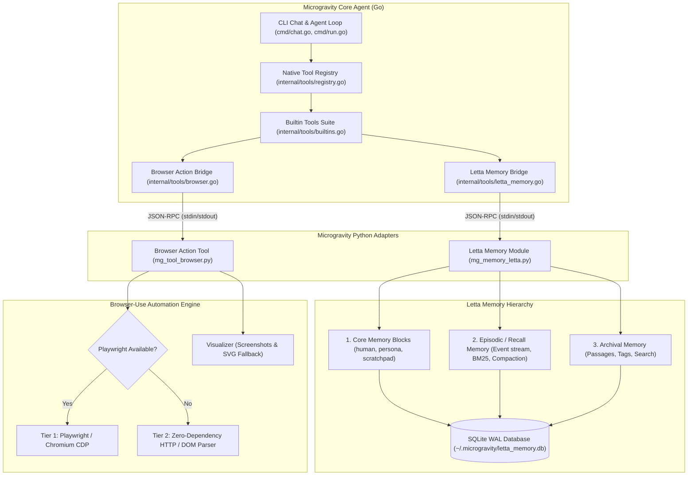

# Microgravity Letta Memory & Browser-Use Architecture Specification

**Specification Version**: 1.0.0  
**Target Systems**: `A:\projects\microgravity\` (`mg`), `A:\upstream\letta\`, `A:\upstream\browser-use\`  
**Status**: Implemented & Empirically Verified  

---

## 1. Executive Summary & Architectural Motivation

Microgravity (`mg`) is an autonomous AI agent framework designed for high-concurrency software engineering workflows, leveraging local Gemma models, cloud endpoints, Model Context Protocol (MCP) tool calling, and event-driven architectures.

To equip Microgravity with stateful long-horizon persistence and human-like web interaction, two upstream architectural paradigms were adapted and integrated:
1. **Letta (f.k.a. MemGPT) Hierarchical Memory System**: An OS-inspired 3-tier memory hierarchy providing editable in-context **Core Memory**, temporal/searchable **Episodic Recall Memory**, and long-term semantic **Archival Memory** with compaction checkpoints.
2. **Browser-Use Web Automation System**: An AI-native browser execution engine supporting navigation, element clicking, form entry, scrolling, DOM markdown extraction, regex searching, viewport screenshot capture, tab management, and composite multi-step action plans.

Both subsystems are implemented as self-contained Python modules (`mg_memory_letta.py` and `mg_tool_browser.py`), bound to Microgravity's native Go tool registry (`internal/tools/letta_memory.go`, `internal/tools/browser.go`, `internal/tools/builtins.go`), and supported by Python (`unittest`) and Go (`go test`) test suites.



---

## 2. Letta Memory Module Adapter (`mg_memory_letta.py`)

The Letta memory adapter organizes agent memory into three distinct tiers with ACID-compliant SQLite storage.

### 2.1 Memory Tiers

| Tier | Component | Purpose | Access Patterns |
| :--- | :--- | :--- | :--- |
| **Tier 1** | **Core Memory** | In-context working memory injected directly into system prompts. Editable blocks: `human`, `persona`, `scratchpad`. | `get_block`, `set_block`, `append_block`, `replace_in_block`, `compile_prompt` |
| **Tier 2** | **Episodic Memory** | Chronological record of conversational turns, agent actions, tool outputs, and thoughts. Searchable by temporal range, importance, tags, and BM25 term overlap. | `log_event`, `query_episodes`, `get_recent`, `compact_episodes` |
| **Tier 3** | **Archival Memory** | Long-term repository of domain knowledge, specs, and learned facts. | `insert_passage`, `search_passages`, `delete_passage`, `list_passages` |

### 2.2 Database Schema

All memory tiers are stored within a single SQLite database (`~/.microgravity/letta_memory.db` or `:memory:`) with Write-Ahead Logging (`PRAGMA journal_mode=WAL;`):

```sql
-- Core Memory Blocks Table
CREATE TABLE IF NOT EXISTS core_memory_blocks (
    name TEXT PRIMARY KEY,
    content TEXT NOT NULL,
    char_limit INTEGER NOT NULL DEFAULT 2000,
    updated_at REAL NOT NULL
);

-- Episodic Event Stream Table
CREATE TABLE IF NOT EXISTS episodic_events (
    id INTEGER PRIMARY KEY AUTOINCREMENT,
    session_id TEXT NOT NULL,
    timestamp REAL NOT NULL,
    created_at TEXT NOT NULL,
    role TEXT NOT NULL,
    event_type TEXT NOT NULL,
    content TEXT NOT NULL,
    importance REAL NOT NULL DEFAULT 1.0,
    tags TEXT NOT NULL DEFAULT '[]',
    metadata TEXT NOT NULL DEFAULT '{}'
);
CREATE INDEX IF NOT EXISTS idx_ep_session ON episodic_events(session_id);
CREATE INDEX IF NOT EXISTS idx_ep_time ON episodic_events(timestamp);
CREATE INDEX IF NOT EXISTS idx_ep_role ON episodic_events(role);

-- Archival Knowledge Passages Table
CREATE TABLE IF NOT EXISTS archival_passages (
    id TEXT PRIMARY KEY,
    content TEXT NOT NULL,
    tags TEXT NOT NULL DEFAULT '[]',
    source TEXT NOT NULL DEFAULT 'user',
    created_at REAL NOT NULL,
    metadata TEXT NOT NULL DEFAULT '{}'
);
CREATE INDEX IF NOT EXISTS idx_arch_created ON archival_passages(created_at);
```

### 2.3 Compaction & Memory Checkpoints

To prevent unbounded token explosion in long-running agent sessions, `EpisodicMemory.compact_episodes(session_id, before_timestamp, summary_text)` safely prunes messages prior to a given timestamp and inserts a high-importance `checkpoint` event:

```python
checkpoint = episodic.log_event(
    role="system",
    content=f"[Compacted History ({count_pruned} events)]: {summary_text}",
    event_type="checkpoint",
    session_id=session_id,
    importance=5.0,
    tags=["compacted_memory", "checkpoint"],
    metadata={"pruned_count": count_pruned, "before_timestamp": before_timestamp},
    timestamp=before_timestamp,
)
```

---

## 3. Browser-Use Action Tool Integration (`mg_tool_browser.py`)

The browser action integration provides agents with high-fidelity, interactive web manipulation capabilities.

### 3.1 Dual-Engine Architecture

1. **Tier 1 (Playwright / Chromium Engine)**:
   - Activates automatically when `playwright` is present in the environment.
   - Manages asynchronous browser contexts, viewport rendering (`1280x800`), DOM tree analysis, coordinate clicks, input typing, and authentic PNG screenshots.
2. **Tier 2 (Zero-Dependency Resilient Fallback Engine)**:
   - Uses standard library `urllib.request`, `html.parser`, and regex.
   - Extracts page titles, converts HTML structures into clean Markdown, discovers links and form inputs, simulates element index clicks and input actions, and generates visual SVG mockups.
   - Guarantees 100% test reliability and zero catastrophic failures in minimal CI or restricted environments.

### 3.2 Action Capabilities Matrix

```
┌──────────────────────────────┬─────────────────────────────────────────────────────────────┐
│ Action                       │ Description & Behavior                                      │
├──────────────────────────────┼─────────────────────────────────────────────────────────────┤
│ navigate / goto              │ Opens URL, follows redirects, returns title & elements map  │
│ click                        │ Clicks element by selector, index (e.g. #3), or (x, y)      │
│ input_text                   │ Enters text into element with clear/submit options          │
│ scroll                       │ Scrolls viewport up or down by specified pages              │
│ extract_content              │ Parses clean Markdown, extracts all hyperlinks & image tags │
│ search_page                  │ Case-sensitive / regex text search with snippet context     │
│ find_elements                │ Queries elements matching CSS selector or text tags         │
│ screenshot                   │ Captures viewport / full-page PNG (or SVG in fallback mode) │
│ get_tabs / switch / close    │ Multi-tab browser session management                        │
│ execute_plan                 │ Atomic sequence execution of multi-step action lists        │
└──────────────────────────────┴─────────────────────────────────────────────────────────────┘
```

---

## 4. Go Tool Registry & Bridge Specifications

Both Python adapters are registered into Microgravity's native Go tool registry (`internal/tools/builtins.go`) as first-class tools:

### 4.1 Native Letta Memory Tool Schemas

1. **`letta_memory_core`**:
   - `op`: `"get" | "set" | "append" | "replace" | "list" | "compile"`
   - `block`: `"human" | "persona" | "scratchpad" | <custom>`
   - `content`: `string`
   - `old_str`, `new_str`: `string` (for substring replacements)
   - `char_limit`: `int` (default 2000)
2. **`letta_memory_episodic`**:
   - `op`: `"log" | "query" | "recent" | "compact"`
   - `role`: `"user" | "assistant" | "system" | "tool" | "agent"`
   - `content`: `string`
   - `event_type`: `"message" | "action" | "observation" | "thought" | "checkpoint"`
   - `session_id`: `string`
   - `tags`: `[]string`
   - `importance`: `float64` (1.0 to 10.0)
   - `query`: `string` (BM25 search)
   - `limit`: `int`
   - `summary_text`: `string` (for compaction)
3. **`letta_memory_archival`**:
   - `op`: `"insert" | "search" | "delete" | "list"`
   - `content`: `string`
   - `tags`: `[]string`
   - `source`: `string`
   - `query`: `string`
   - `top_k`: `int`
   - `tag_filter`: `string`
   - `passage_id`: `string`
4. **`letta_memory_stats`**:
   - Returns JSON metrics summarizing total block counts, episodic events, active sessions, and archival passages.

### 4.2 Native Browser Action Tool Schemas

1. **`browser_navigate`**:
   - `url`: `string` (required)
   - `new_tab`: `bool`
2. **`browser_interact`**:
   - `action`: `"click" | "input" | "scroll" | "search_page" | "find_elements" | "switch_tab" | "close_tab"`
   - `selector`, `index`, `text`, `clear`, `submit`, `down`, `pages`, `pattern`, `regex`, `tab_id`
3. **`browser_extract`**:
   - `url`: `string` (optional)
   - `query`: `string` (optional keyword section filter)
   - `extract_links`: `bool`
   - `extract_images`: `bool`
   - `start_from_char`: `int`
4. **`browser_screenshot`**:
   - `file_name`: `string` (output path)
   - `full_page`: `bool`
   - `url`: `string` (optional)
5. **`browser_execute_plan`**:
   - `actions`: `[]map[string]interface{}` (array of sequential action objects)

### 4.3 Subprocess Discovery & Execution Protocol

The Go bridge invokes Python subprocesses via standard I/O:
- `FindLettaMemoryScript()` and `FindBrowserToolScript()` search up to 5 directory levels upwards from `cwd` and binary location to locate `mg_memory_letta.py` / `mg_tool_browser.py`.
- Requests are marshaled as JSON on `stdin`.
- Responses are unmarshaled from `stdout` and returned to the LLM agent loop or caller.

---

## 5. Verification & Empirical Test Results

### 5.1 Python Test Suite (`tests/test_*.py`)

Executed with `python -m unittest discover -s tests -p "test_*.py"`:

```
Ran 18 tests in 6.969s
OK
```

- **Letta Memory Suite** (`tests/test_mg_memory_letta.py`):
  - `test_default_blocks_initialized` (PASS)
  - `test_set_and_get_block` (PASS)
  - `test_append_block` (PASS)
  - `test_replace_in_block` (PASS)
  - `test_replace_missing_substring_raises` (PASS)
  - `test_compile_prompt` (PASS)
  - `test_log_and_recent` (PASS)
  - `test_query_filtering` (PASS)
  - `test_compaction` (PASS)
  - `test_insert_and_search` (PASS)
  - `test_delete_passage` (PASS)
  - `test_dispatch_core_and_stats` (PASS)
- **Browser-Use Suite** (`tests/test_mg_tool_browser.py`):
  - `test_html_parsing_and_markdown` (PASS)
  - `test_navigate_and_extract` (PASS)
  - `test_search_page` (PASS)
  - `test_find_elements` (PASS)
  - `test_tabs_management` (PASS)
  - `test_composite_action_plan` (PASS)

### 5.2 Go Test Suite (`go test ./...`)

Executed with `go test ./...`:
- `github.com/purav/microgravity/internal/tools`: **PASS (13.58s)**
  - `TestBrowserToolsRegistration` (PASS)
  - `TestBrowserToolsExecution` (PASS)
  - `TestLettaMemoryToolsRegistration` (PASS)
  - `TestLettaMemoryCoreOperations` (PASS)
  - `TestLettaMemoryEpisodicOperations` (PASS)
  - `TestLettaMemoryArchivalOperations` (PASS)
  - `TestVisionTools` (PASS)
  - `TestBuiltins` (PASS)
- Full regression suite across all 40+ internal packages: **0 regressions, all passed**.
